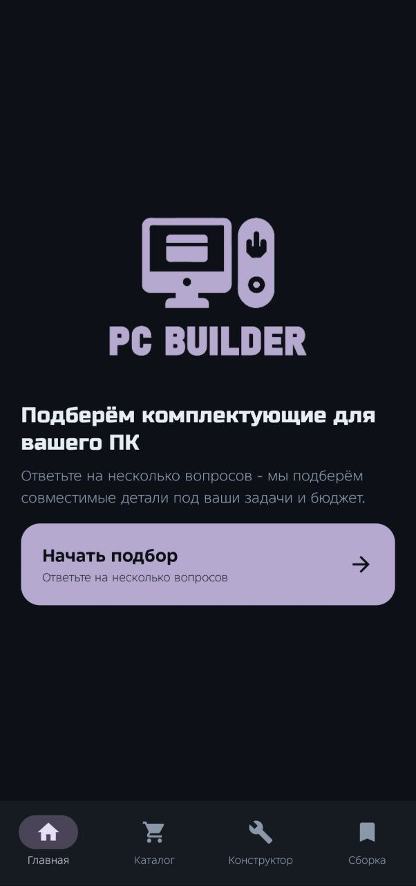
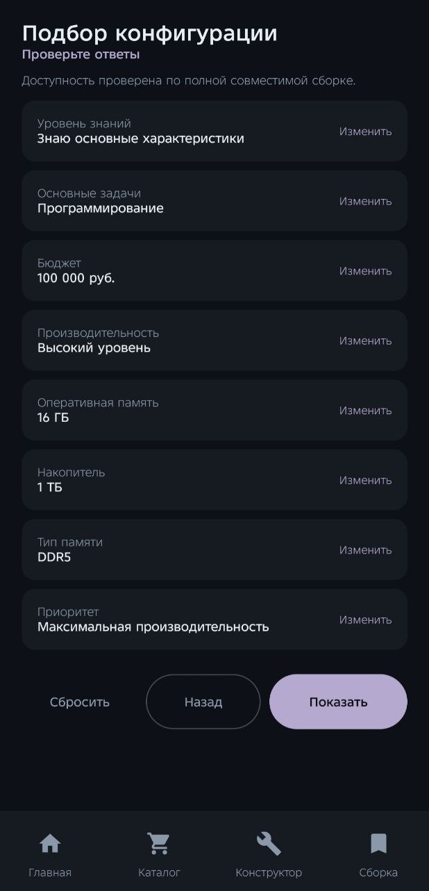
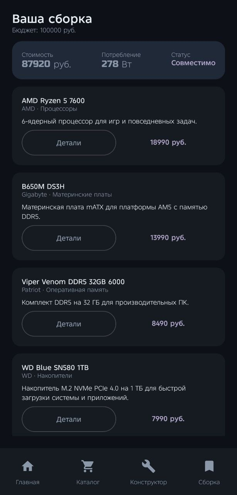
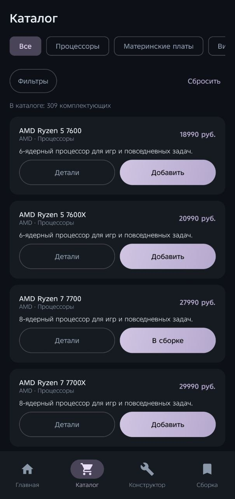
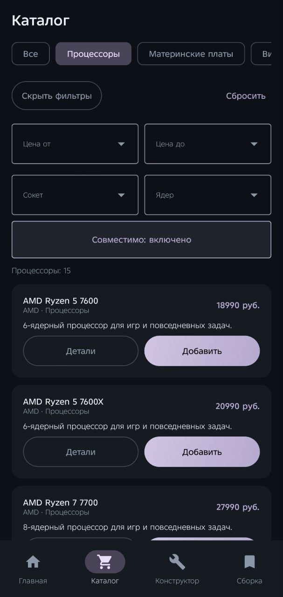
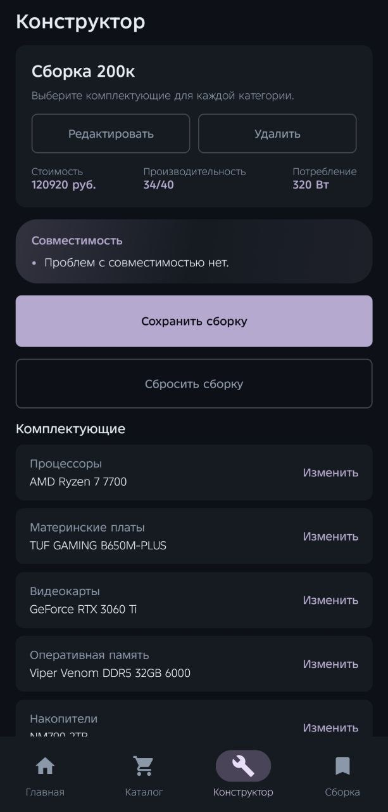

# PC Component Builder

[](https://kotlinlang.org)
[](https://developer.android.com)
[](https://developer.android.com/jetpack/compose)
[](LICENSE)

**Русский** | [English](#english)

## О проекте

PC Component Builder - демонстрационное Android-приложение для подбора
комплектующих персонального компьютера, проверки совместимости, расчёта
стоимости и энергопотребления. Приложение работает полностью офлайн: каталог
из 309 комплектующих хранится внутри APK в JSON-файле, сервер и внешние API не
используются.

Проект показывает полный цикл работы с локальными данными: анкету подбора,
алгоритм рекомендаций, конструктор сборки, правила совместимости и сохранение
конфигураций на устройстве.

## Скриншоты

<p align="center">
  
  
  
  
</p>

<p align="center">
  
  
  
  
</p>

Дополнительные скриншоты находятся в папке [`docs/screenshots`](docs/screenshots).

## Возможности

- Каталог комплектующих с поиском, фильтрами и группировкой по категориям.
- Ручной выбор комплектующих в конструкторе сборки.
- Анкета из 8 шагов: опыт, задачи, бюджет, производительность, память,
  накопитель, тип памяти и приоритет выбора.
- Автоматический подбор совместимой сборки по ответам пользователя.
- Проверка совместимости: сокет, память, охлаждение, форм-фактор, длина
  видеокарты, мощность блока питания и разъёмы питания.
- Расчёт ориентировочной стоимости и энергопотребления.
- Экран результата с пояснениями, предупреждениями и статусом сборки.
- Сохранение, просмотр и удаление конфигураций на устройстве.
- Тёмная тема и адаптация под портретную ориентацию смартфона.

## Технологии

- Kotlin 2.2.20.
- Android SDK, минимальная версия API 24, targetSdk 37.
- Jetpack Compose и Material 3.
- Navigation Compose.
- Kotlin Serialization.
- ViewModel и StateFlow.
- SharedPreferences для локального хранения сборок.
- Gradle Kotlin DSL и Gradle Wrapper 9.6.0.
- JUnit 4 и Compose UI Test.

## Структура проекта

```text
PCcomponent/
  app/
    src/main/
      assets/catalog/components.json
      assets/licenses/RussoOne-OFL.txt
      java/com/example/pccomponent/
        MainActivity.kt
        data/model
        data/repository
        data/storage
        domain/calculator
        domain/chatbot
        domain/compatibility
        domain/feasibility
        domain/questionnaire
        domain/recommendation
        performance
        presentation
        ui
        ui/components
        ui/theme
      res/
      AndroidManifest.xml
    src/test/
    src/androidTest/
  docs/
    data-and-project-structure.md
    screenshots/
    technical-specification.md
  gradle/
  build.gradle.kts
  settings.gradle.kts
  gradle.properties
```

Подробное описание данных, исходников и потока данных приведено в
[`docs/data-and-project-structure.md`](docs/data-and-project-structure.md).

## Быстрый старт

```bash
git clone https://github.com/coushid/pc-component-builder.git
cd PCcomponent
```

Откройте папку проекта в Android Studio, дождитесь синхронизации Gradle и
запустите конфигурацию `app` на эмуляторе или устройстве.

## Требования

- Android Studio с поддержкой Android Gradle Plugin 9.4.1 и compileSdk 37.
- JDK 17 или новее. Проект проверен на JDK 25.
- Android SDK Platform 37 и Build Tools, установленные через SDK Manager.
- Эмулятор или устройство с Android 7.0 (API 24) и выше.
- Свободное место для Gradle, зависимостей и эмулятора.

## Переменные окружения

Обязательных переменных окружения нет. Путь к Android SDK задаётся в
`local.properties` автоматически при открытии проекта в Android Studio.
Файл `local.properties` содержит локальный абсолютный путь и исключён из Git.
Не добавляйте в него ключи, пароли или токены.

## Запуск проекта

Из Android Studio:

1. Откройте проект.
2. Выберите устройство или создайте эмулятор.
3. Нажмите Run для модуля `app`.

Из терминала:

```bash
./gradlew installDebug
```

В Windows:

```powershell
.\gradlew.bat installDebug
```

## Сборка и тесты

Модульные тесты:

```bash
./gradlew testDebugUnitTest
```

Сборка debug APK:

```bash
./gradlew assembleDebug
```

Готовый файл появится по пути `app/build/outputs/apk/debug/app-debug.apk`.

Инструментальные тесты требуют подключённого устройства или запущенного
эмулятора:

```bash
./gradlew connectedDebugAndroidTest
```

В Windows замените `./gradlew` на `.\gradlew.bat`. В проекте 34 модульных теста:
они проверяют каталог, совместимость, рекомендации, анкету и расчёт мощности.

## Примеры использования

- Пройдите анкету, выберите задачи и бюджет, затем нажмите «Показать», чтобы
  получить готовую сборку с ценой и статусом совместимости.
- Откройте каталог, включите фильтры по цене, сокету и количеству ядер,
  чтобы сузить список комплектующих.
- Добавьте комплектующие в конструктор вручную и проверьте предупреждения о
  совместимости и превышении бюджета.
- Сохраните удачную сборку и вернитесь к ней позже на экране «Сборка».

## Ограничения и известные проблемы

- Каталог демонстрационный: 309 позиций с фиксированными ценами.
- Цены и характеристики не синхронизируются с магазинами и могут быть
  неактуальными.
- Приложение не выполняет заказ комплектующих и не является интернет-магазином.
- Нет регистрации, авторизации, облачной синхронизации и сетевых запросов.
- Release-сборка не подписана: для публикации потребуется собственный keystore.
- Интерфейс приложения на русском языке.
- Для инструментальных тестов нужен эмулятор или физическое устройство.
- CI-конфигурация в репозиторий не добавлена.

## Лицензия

Проект распространяется по лицензии MIT. Подробности в файле [`LICENSE`](LICENSE).

## English

### About

PC Component Builder is a demo Android application for choosing PC components,
checking compatibility, and estimating build cost and power consumption. The app
works fully offline. Its catalog of 309 components is stored inside the APK as a
JSON asset, with no server and no external API.

The project demonstrates a complete local data flow: a recommendation
questionnaire, a build solver, compatibility rules, a manual builder, and saved
configurations on the device.

### Screenshots

Screenshots are available in [`docs/screenshots`](docs/screenshots).

### Features

- Component catalog with filters and category grouping.
- Manual build editor with per-category selection.
- An 8-step questionnaire: experience, tasks, budget, performance, memory,
  storage, memory type, and priority.
- Automatic selection of a compatible build.
- Compatibility checks for socket, memory, cooling, form factor, GPU length,
  PSU capacity, and GPU power connectors.
- Estimated total price and power consumption.
- Result screen with explanations and warnings.
- Local save, open, and delete for build configurations.
- Dark theme optimized for portrait phone screens.

### Tech stack

- Kotlin 2.2.20.
- Android SDK with minSdk 24 and targetSdk 37.
- Jetpack Compose and Material 3.
- Navigation Compose.
- Kotlin Serialization.
- ViewModel and StateFlow.
- SharedPreferences for saved builds.
- Gradle Kotlin DSL and Gradle Wrapper 9.6.0.
- JUnit 4 and Compose UI Test.

### Project layout

```text
PCcomponent/
  app/
    src/main/
      assets/catalog/components.json
      java/com/example/pccomponent/
        data
        domain
        performance
        presentation
        ui
    src/test/
    src/androidTest/
  docs/
  gradle/
  build.gradle.kts
  settings.gradle.kts
```

### Quick start

```bash
git clone https://github.com/coushid/pc-component-builder.git
cd PCcomponent
```

Open the project in Android Studio, wait for Gradle sync, and run the `app`
configuration on an emulator or device.

### Requirements

- Android Studio with Android Gradle Plugin 9.4.1 and compileSdk 37 support.
- JDK 17 or newer. The project was verified with JDK 25.
- Android SDK Platform 37 and Build Tools installed through SDK Manager.
- An emulator or device running Android 7.0 (API 24) or newer.
- Disk space for Gradle, dependencies, and the emulator.

### Environment variables

No environment variables are required. Android Studio writes the SDK path to
`local.properties`. That file is local, ignored by Git, and must not contain
secrets.

### Run

From Android Studio, select a device or create an emulator, then run the `app`
module.

From a terminal:

```bash
./gradlew installDebug
```

On Windows:

```powershell
.\gradlew.bat installDebug
```

### Build and tests

Run unit tests:

```bash
./gradlew testDebugUnitTest
```

Build a debug APK:

```bash
./gradlew assembleDebug
```

The APK is written to `app/build/outputs/apk/debug/app-debug.apk`.

Run instrumented tests with a connected device or running emulator:

```bash
./gradlew connectedDebugAndroidTest
```

On Windows, use `.\gradlew.bat` instead of `./gradlew`. The project contains 34
unit tests covering the catalog, compatibility, recommendations, questionnaire,
and power calculation.

### Usage examples

- Complete the questionnaire and press "Show" to get a compatible build with
  total price and compatibility status.
- Open the catalog and filter by price, socket, and core count.
- Add components manually in the builder and review compatibility and budget
  warnings.
- Save a build and return to it later from the "Build" screen.

### Limitations and known issues

- The catalog is a demo: 309 components with fixed prices.
- Prices and specifications are not synced with stores and may be outdated.
- The app does not place orders and is not an online store.
- There is no sign-in, cloud sync, or network access.
- The release build is unsigned and requires your own keystore for publishing.
- The app UI is in Russian.
- Instrumented tests require an emulator or a physical device.
- No CI configuration is included.

### License

This project is licensed under the MIT License. See [`LICENSE`](LICENSE).
